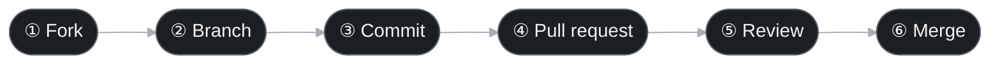

<!--
  Octonary Robotics · GitHub organization profile
  Location: <org>/.github repository → profile/README.md, images in profile/assets/

  Before publishing, replace:
  1. Every "octonary-robotics" → your organization's GitHub login (used by image URLs, badges and cards)
  2. Placeholders in [square brackets] (website, email, social handles)
  3. REPLACE_ME_1…4 → the repositories you want to feature
  4. The icon IDs under "Stack" to match your real stack (see https://skillicons.dev)
-->

<picture>
  <source media="(prefers-color-scheme: dark)" srcset="https://raw.githubusercontent.com/octonary-robotics/.github/main/profile/assets/banner-dark.svg">
  
</picture>

  <picture>
    <source media="(prefers-color-scheme: dark)" srcset="https://readme-typing-svg.demolab.com?font=Sora&weight=500&size=18&duration=2800&pause=900&color=F4F3EF&center=true&vCenter=true&width=640&height=44&lines=Mechanical+tentacles%2C+engineered+segment+by+segment.;Eight+segments.+One+reach.;Soft+motion%2C+hard+engineering.">
    
  </picture>

  
  
  
  

  A robotics collective building <b>mechanical tentacles</b>, one segment at a time.

 

<!-- ───────────────────────────── 01 About ───────────────────────────── -->

<picture>
  <source media="(prefers-color-scheme: dark)" srcset="https://raw.githubusercontent.com/octonary-robotics/.github/main/profile/assets/h01-dark.svg">
  
</picture>

**Octonary Robotics** builds **mechanical tentacles**. We break a tentacle down into geometric joints and design, drive and test each one in turn, so machines can extend, bend and grasp with the flexibility of a living limb.

<picture>
  <source media="(prefers-color-scheme: dark)" srcset="https://raw.githubusercontent.com/octonary-robotics/.github/main/profile/assets/mark-dark.svg">
  
</picture>

<!-- ───────────────────────────── 02 Focus ───────────────────────────── -->

<picture>
  <source media="(prefers-color-scheme: dark)" srcset="https://raw.githubusercontent.com/octonary-robotics/.github/main/profile/assets/h02-dark.svg">
  
</picture>

<!-- These four areas are examples; adjust them to the organization's actual work -->

<table>
  <tr>
    <td width="50%" valign="top">
      <h3>◢ Mechanical design</h3>
      
Segmented tentacle structures, joints and materials that balance flexibility with stiffness.

      
<kbd>CAD</kbd> <kbd>Joints</kbd> <kbd>Materials</kbd>

    </td>
    <td width="50%" valign="top">
      <h3>◢ Actuation &amp; control</h3>
      
Tendon drives, motors and control algorithms that position every segment precisely and in concert.

      
<kbd>Embedded</kbd> <kbd>Motion control</kbd> <kbd>Firmware</kbd>

    </td>
  </tr>
  <tr>
    <td width="50%" valign="top">
      <h3>◢ Sensing</h3>
      
Pose, force and contact sensing, so the tentacle knows where it is and what it touches.

      
<kbd>Sensors</kbd> <kbd>State estimation</kbd> <kbd>Calibration</kbd>

    </td>
    <td width="50%" valign="top">
      <h3>◢ Simulation &amp; tooling</h3>
      
Kinematic models, simulation environments and dev tools that shorten the path from design to hardware.

      
<kbd>Kinematics</kbd> <kbd>Simulation</kbd> <kbd>Toolchain</kbd>

    </td>
  </tr>
</table>

 

<!-- ───────────────────────────── 03 Stack ───────────────────────────── -->

<picture>
  <source media="(prefers-color-scheme: dark)" srcset="https://raw.githubusercontent.com/octonary-robotics/.github/main/profile/assets/h03-dark.svg">
  
</picture>

<!-- Icon IDs: https://skillicons.dev — add or remove to match the real stack -->

  <picture>
    <source media="(prefers-color-scheme: dark)" srcset="https://skillicons.dev/icons?i=cpp,py,js,ros,pytorch,solidjs,arduino,docker,git,blender&theme=dark&perline=10">
    
  </picture>

 

<!-- ───────────────────────────── 04 Projects ───────────────────────────── -->

<picture>
  <source media="(prefers-color-scheme: dark)" srcset="https://raw.githubusercontent.com/octonary-robotics/.github/main/profile/assets/h04-dark.svg">
  
</picture>

<!-- Replace REPLACE_ME_1…4 with real repository names; cards are generated by github-readme-stats -->

<table>
  <tr>
    <td width="50%">
      <a href="https://github.com/octonary-robotics/REPLACE_ME_1">
        <picture>
          <source media="(prefers-color-scheme: dark)" srcset="https://github-readme-stats.vercel.app/api/pin/?username=octonary-robotics&repo=REPLACE_ME_1&bg_color=14171B&title_color=F4F3EF&text_color=A9AEB5&icon_color=F4F3EF&border_color=2A2F36&border_radius=10">
          
        </picture>
      </a>
    </td>
    <td width="50%">
      <a href="https://github.com/octonary-robotics/REPLACE_ME_2">
        <picture>
          <source media="(prefers-color-scheme: dark)" srcset="https://github-readme-stats.vercel.app/api/pin/?username=octonary-robotics&repo=REPLACE_ME_2&bg_color=14171B&title_color=F4F3EF&text_color=A9AEB5&icon_color=F4F3EF&border_color=2A2F36&border_radius=10">
          
        </picture>
      </a>
    </td>
  </tr>
  <tr>
    <td width="50%">
      <a href="https://github.com/octonary-robotics/REPLACE_ME_3">
        <picture>
          <source media="(prefers-color-scheme: dark)" srcset="https://github-readme-stats.vercel.app/api/pin/?username=octonary-robotics&repo=REPLACE_ME_3&bg_color=14171B&title_color=F4F3EF&text_color=A9AEB5&icon_color=F4F3EF&border_color=2A2F36&border_radius=10">
          
        </picture>
      </a>
    </td>
    <td width="50%">
      <a href="https://github.com/octonary-robotics/REPLACE_ME_4">
        <picture>
          <source media="(prefers-color-scheme: dark)" srcset="https://github-readme-stats.vercel.app/api/pin/?username=octonary-robotics&repo=REPLACE_ME_4&bg_color=14171B&title_color=F4F3EF&text_color=A9AEB5&icon_color=F4F3EF&border_color=2A2F36&border_radius=10">
          
        </picture>
      </a>
    </td>
  </tr>
</table>

> [!NOTE]
> More repositories are being opened up over time. Star or watch the ones you care about to hear about updates first.

 

<!-- ───────────────────────────── 05 Contribute ───────────────────────────── -->

<picture>
  <source media="(prefers-color-scheme: dark)" srcset="https://raw.githubusercontent.com/octonary-robotics/.github/main/profile/assets/h05-dark.svg">
  
</picture>

Issues, ideas and pull requests are all welcome. Like a tentacle, every contribution moves forward one segment at a time:

> [!TIP]
> New here? Look for issues labelled <kbd>good first issue</kbd>, and read our [contributing guide](https://github.com/octonary-robotics/.github/blob/main/CONTRIBUTING.md) and [code of conduct](https://github.com/octonary-robotics/.github/blob/main/CODE_OF_CONDUCT.md) before opening a pull request.

 

<!-- ───────────────────────────── 06 Contact ───────────────────────────── -->

<picture>
  <source media="(prefers-color-scheme: dark)" srcset="https://raw.githubusercontent.com/octonary-robotics/.github/main/profile/assets/h06-dark.svg">
  
</picture>

| Channel | Where to find us |
|:---:|:---|
|  | [your-website] |
|  | octonary-robotics@yahoo.com |
|  | [linkedin.com/company/…] |
|  | [@your-handle] |

 

  

<picture>
  <source media="(prefers-color-scheme: dark)" srcset="https://capsule-render.vercel.app/api?type=waving&section=footer&height=140&color=0:14171B,100:2A2F36&text=Segment%20by%20segment.&fontColor=F4F3EF&fontSize=22&fontAlign=50&fontAlignY=72">
  
</picture>

[^1]: *octonary* (adj.): of or relating to the number eight; based on eight.
